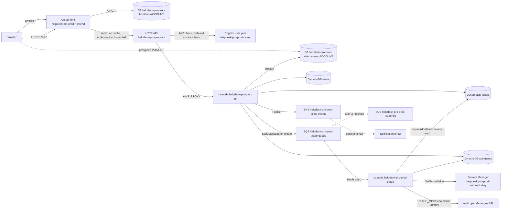

# Helpdesk Pro

A support ticketing app for an IT and customer support team. Customers raise tickets, agents work them, and
admins see the numbers and manage users. Every new ticket is triaged by Claude through the Anthropic API, with a
keyword fallback so ticket creation never fails.

- Architecture and every AWS resource: [docs/ARCHITECTURE.md](docs/ARCHITECTURE.md)
- HTTP API reference: [docs/API.md](docs/API.md)
- Local API details: [backend/README-local.md](backend/README-local.md)
- Frontend details: [frontend/README.md](frontend/README.md)

## What it does

**Sign-in and roles**
- Cognito sign-in (SRP) with three roles from Cognito groups: Customer, Agent and Admin.
- Customers see only their own tickets. Agents see all tickets. Admins also get the dashboard and user management.

**Ticket intake**
- Title, description and category, with an optional screenshot or PDF. Uploads go straight to a private S3
  bucket through a presigned URL, and the API checks the object's type and size before it accepts it.

**AI triage**
- On creation, a message goes to SQS. The triage Lambda asks Claude for a category, priority (Low, Medium,
  High, Urgent), sentiment, a one-line summary and a suggested reply.
- On any failure the Lambda applies keyword rules instead. Each ticket shows its triage source: `ai` or `rules`.
  When AI fell back, the admin and agent views show the short reason.

**Agent workspace**
- List view with search and filters (status, priority, category, assignee, "mine").
- Kanban board with New, In Progress, Waiting and Resolved columns.
- Assign to yourself or another agent. Public replies go to the customer. Internal notes stay with staff.
- Activity timeline for each ticket.

**Manager dashboard (Admin)**
- Open versus resolved, volume by category, tickets per agent, unassigned count and average first-response time.

**Notifications**
- An SNS topic publishes assignment and reply events. An optional email subscription is created only when
  `notification_email` is set.

**Out of scope:** SLA timers, a knowledge base.

## Stack

| Layer | Technology |
|---|---|
| Frontend | React 18.3, Vite 5.4, TypeScript 5.6 (strict), Tailwind CSS 3.4, React Router 6.30, `amazon-cognito-identity-js` 6.3 |
| Backend | Python 3.12 Lambda functions, boto3 from the Lambda runtime (no other runtime packages) |
| Data | DynamoDB (on-demand, point-in-time recovery, encryption), S3 for attachments |
| Auth | Cognito user pool, API Gateway JWT authorizer |
| Messaging | SQS (triage queue and dead-letter queue), SNS (ticket events) |
| AI triage | Anthropic Messages API, key in Secrets Manager. No other model service is used. |
| Edge | CloudFront (frontend and `/api/*` on one origin), S3 with origin access control |
| Infrastructure | Terraform (AWS provider ~> 5.80, Terraform >= 1.6; CI pins 1.17.0) |
| CI/CD | GitHub Actions, manual `deploy` workflow with OIDC login and a `production` environment |

## Architecture



## Repository layout

```
.github/workflows/deploy.yml   manual deploy: Terraform, frontend build and upload, smoke test
backend/
  src/helpdesk/                API and triage code (api_handler.py, triage_handler.py, tickets.py, triage*.py, ...)
  scripts/                     local_server.py (preview), seed.py (25 demo tickets), smoke_triage.py (deploy check)
  tests/                       pytest suite (moto, no AWS account needed)
frontend/
  src/features/                auth, tickets, workspace (Kanban), dashboard, users
  src/lib/                     API client, auth (local and Cognito), roles.ts (every role rule)
  src/components/ui/           shared primitives
infra/
  *.tf                         the main stack (DynamoDB, S3, Cognito, Lambda, API Gateway, SQS, SNS, CloudFront)
  bootstrap/                   state bucket and lock table, created once by create-state.sh
docs/
  ARCHITECTURE.md              every AWS resource, deployment steps, deploy role policy, cost, open decisions
  API.md                       routes, roles, error shapes, notifications, triage contract
```

## Roles and permissions

Roles come from the Cognito group in the ID token. A user with no group is a Customer. If a user is in several
groups, the highest role applies (Admin, then Agent, then Customer). The UI hides controls by role, and the API
checks the same rules again.

| Capability | Customer | Agent | Admin |
|---|:---:|:---:|:---:|
| Create a ticket, see and reply on own tickets | Yes | Yes | Yes |
| Attach files to own tickets | Yes | Yes | Yes |
| See all tickets, search and filter the workspace | No | Yes | Yes |
| Kanban board, change status, priority or category | No | Yes | Yes |
| Assign tickets (to self or another agent) | No | Yes | Yes |
| Post internal notes | No | Yes | Yes |
| See triage details (suggested reply, error reason) | No | Yes | Yes |
| Dashboard (`GET /api/dashboard`) | No | No | Yes |
| List users and change roles (`/api/users`) | No | No | Yes |

Customers see only public comments and public timeline events. An admin cannot remove their own admin role.
A role change takes effect at the user's next token refresh (up to 60 minutes). A demotion also signs the user out
at once, through the API's Cognito permissions.

## Local development

You need Python 3.12 and Node 20 or later.

### Backend (local API)

```bash
cd backend
python3.12 -m venv .venv
.venv/bin/pip install -r requirements-dev.txt
LOCAL_API_PORT=8000 .venv/bin/python scripts/local_server.py     # http://127.0.0.1:8000
```

The local server binds to 127.0.0.1 and uses moto, so data lives in memory. It is re-seeded at each start.
It forces two settings:

- `AUTH_MODE=local`: send `X-Dev-User: <seeded email>` instead of a token. Local mode is refused inside Lambda.
- `TRIAGE_MODE=keyword`: triage runs in process with the keyword rules. The local server never calls the
  Anthropic API or Secrets Manager.

```bash
curl http://127.0.0.1:8000/api/health
curl -H "X-Dev-User: priya.raman@example.test" http://127.0.0.1:8000/api/tickets
```

**Seeded demo users** (use the email as `X-Dev-User`):

| Role | Emails |
|---|---|
| Admin | `dana.okoye@example.test` |
| Agent | `priya.raman@example.test`, `marcus.chen@example.test`, `lena.costa@example.test`, `tomasz.nowak@example.test` |
| Customer | `sam.okafor@example.test`, `elena.ruiz@example.test`, `jordan.lee@example.test`, `aisha.khan@example.test`, `ben.walsh@example.test` |

The seed writes 25 tickets with comments and timeline events, with mixed statuses and priorities.

### Frontend (preview)

```bash
cd frontend
npm ci
npm run dev        # http://127.0.0.1:3000, proxies /api to 127.0.0.1:8000
```

Start the backend first. In local mode the sign-in page lists the seeded users. `VITE_AUTH_MODE` defaults to
`local`. Only the deployment build sets it to `cognito`. Copy `frontend/.env.example` to `.env.local` only if you
need to change a public value.

## Tests

Run these from the repository root unless a `cd` is shown.

| Check | Command | Last run |
|---|---|---|
| Backend tests | `cd backend && .venv/bin/python -m pytest -q` | 148 passed |
| Backend compile check | `cd backend && .venv/bin/python -m compileall -q src scripts` | clean |
| Frontend typecheck | `cd frontend && npm run typecheck` | clean |
| Frontend lint (zero warnings allowed) | `cd frontend && npm run lint` | clean |
| Frontend unit tests (Vitest) | `cd frontend && npm test` | 66 passed |
| Frontend production build (typecheck, then build to `dist/`) | `cd frontend && npm run build` | built |
| Terraform format | `cd infra && terraform fmt -check -recursive` | clean |
| Terraform validate (no AWS calls) | `cd infra && terraform init -backend=false -input=false && terraform validate -no-color` | valid |
| Bootstrap validate (no AWS calls) | `cd infra/bootstrap && terraform init -backend=false -input=false && terraform validate -no-color` | valid |

No test needs AWS or the Anthropic API. The backend tests use moto and a fake HTTP transport with a placeholder key.

## Deployment

Deployment runs in the person's AWS account, from GitHub Actions. Nothing deploys on push. The `deploy` workflow
runs only when someone starts it by hand (`workflow_dispatch`). It has two jobs: `plan` (no environment, shows the Terraform
plan) and `apply` (waits for a `production` reviewer, then applies that saved plan and publishes the frontend).

Replace `<ACCOUNT_ID>` below with the AWS account ID. Run the commands in your own terminal with your own
credentials. Do not paste keys or passwords into chat or shell history.

### 1. Bootstrap the Terraform state (once)

The state bucket and lock table must exist before `terraform init` in `/infra` can run.

```bash
EXPECTED_ACCOUNT_ID=<ACCOUNT_ID> AWS_REGION=us-east-1 ./infra/bootstrap/create-state.sh        # prints the plan, exits 1
EXPECTED_ACCOUNT_ID=<ACCOUNT_ID> AWS_REGION=us-east-1 ./infra/bootstrap/create-state.sh --yes  # applies
```

This creates `helpdesk-pro-prod-tfstate-<ACCOUNT_ID>` (versioned, encrypted, private, TLS only) and the lock
table `helpdesk-pro-prod-tflock`. The bootstrap's own state is local, in `infra/bootstrap/terraform.tfstate`. Keep that file safe.

### 2. Initialise the main stack (optional, for local inspection)

The workflow runs this step itself. Run it locally only if you want to read the state. The backend block is empty
on purpose, so every setting is passed here:

```bash
ACCOUNT_ID="$(aws sts get-caller-identity --query Account --output text)"
cd infra
terraform init -input=false \
  -backend-config="bucket=helpdesk-pro-prod-tfstate-${ACCOUNT_ID}" \
  -backend-config="key=helpdesk-pro-prod/terraform.tfstate" \
  -backend-config="region=us-east-1" \
  -backend-config="dynamodb_table=helpdesk-pro-prod-tflock" \
  -backend-config="encrypt=true"
```

### 3. Create the deploy role (one time, by the person)

Terraform does not create the role the workflow uses. Create it in IAM:

- An OIDC identity provider for `token.actions.githubusercontent.com`, if the account does not have one.
- A role whose trust policy allows only this repository's `production` environment
  (`repo:<OWNER>/<REPO>:environment:production`, for the apply job) and its `main` branch
  (`repo:<OWNER>/<REPO>:ref:refs/heads/main`, for the plan job, which has no environment). The trust policy is in
  [docs/ARCHITECTURE.md](docs/ARCHITECTURE.md#deploy-role-policy).
- The permissions policy `helpdesk-pro-prod-deploy-policy`, from the same section, with `<ACCOUNT_ID>` replaced.

Then, in GitHub:

- Repository variable `AWS_DEPLOY_ROLE_ARN`: the role's ARN.
- Repository variable `NOTIFICATION_EMAIL`: optional. Leave it empty for no email subscription.
- Environment `production`: add required reviewers.

### 4. First deploy (workflow)

GitHub, Actions, `deploy`, Run workflow. The workflow then:

1. `plan` job: signs in to AWS with OIDC, resolves the account ID, runs `terraform init` with the backend settings,
   then `terraform plan -out=tfplan`. The plan text is written to the run's job summary, and `tfplan` is uploaded as a
   one-day artifact. Nothing changes in AWS in this job. The artifact is sensitive: it can hold values in clear text.
2. `apply` job: waits for a `production` reviewer. Read the plan summary of this run first; approve only if it is right.
   The job then signs in, runs `terraform init`, downloads `tfplan` and runs `terraform apply tfplan` (no auto-approve).
   Terraform refuses the saved plan if the state changed since it was made.
3. Builds the frontend in Cognito mode. The build fails if local-only code (`X-Dev-User`, demo emails) is in it.
4. Uploads the frontend to S3, invalidates CloudFront, and runs the AI triage smoke test.

The `plan` job has no environment, so it runs without approval and can assume the same deploy role. See the plan job
trust note in `docs/ARCHITECTURE.md` (Main stack).

**The first run is expected to fail at the smoke test.** Terraform creates the Anthropic key secret with no
value, so triage falls back to rules until step 5 is done. Apply still succeeds, so the infrastructure is in place.

### 5. Set the Anthropic API key (one time, by the person)

The key needs an Anthropic account with API billing. Create it in the Anthropic console, then run this in your own
terminal. It reads the key without echoing it, and the value never enters the repo, the pipeline or the logs:

```bash
read -rs KEY && aws secretsmanager put-secret-value --secret-id helpdesk-pro-prod-anthropic-key --secret-string "$KEY" && unset KEY
```

### 6. Create the smoke customer (one time, by the person)

The smoke test signs in as one customer and creates a ticket through the live API. Use the user pool ID from the
`user_pool_id` output:

```bash
POOL_ID="<user_pool_id output>"
SMOKE_EMAIL="<the email you choose>"
read -rs SMOKE_PW && echo
aws cognito-idp admin-create-user --user-pool-id "$POOL_ID" --username "$SMOKE_EMAIL" \
  --message-action SUPPRESS \
  --user-attributes Name=email,Value="$SMOKE_EMAIL" Name=email_verified,Value=true
aws cognito-idp admin-set-user-password --user-pool-id "$POOL_ID" --username "$SMOKE_EMAIL" \
  --password "$SMOKE_PW" --permanent
unset SMOKE_PW
```

Do not add the smoke user to a group, so it stays a Customer. The password must be permanent. A temporary password
returns a challenge instead of an ID token, and the workflow stops with a clear error.

### 7. Store the smoke user as production secrets (one time)

In the `production` environment, add two environment secrets, `SMOKE_USER_EMAIL` and `SMOKE_USER_PASSWORD`, on the
GitHub settings page, or with the CLI. Type the password at the prompt. Do not pass it as an argument:

```bash
gh secret set SMOKE_USER_EMAIL --env production
gh secret set SMOKE_USER_PASSWORD --env production
```

### 8. Re-run the workflow

Run `deploy` again. Terraform makes no changes on the second run, and the smoke test should pass.

Each run creates one smoke ticket titled `[smoke test] AI triage check <time>`. Close them from the agent
workspace (search for `[smoke test]`, set Resolved), or leave them. Nothing else reads them.

## Post-deploy verification

1. **Workflow.** The smoke step ends with `smoke: PASS, triage_source=ai, ...`. A failure prints
   `triage_source` and `triage_error`.
2. **Health.** `curl -s https://<deployed_url>/api/health` returns `{"status": "ok"}`. `deployed_url` is the Terraform
   output of that name (the workflow reads it in its "Read Terraform outputs" step).
3. **Triage in the app.** Sign in as an agent, open a new ticket, and check that its triage panel shows **AI** with
   the model name (`triage_model`, for example `claude-haiku-5-5`). A rules result shows the reason instead.
4. **Timeline and logs.** The ticket timeline reads `AI triage (<model>) completed`. If the panel shows rules instead,
   check `/aws/lambda/helpdesk-pro-prod-triage` in CloudWatch Logs for the reason.

## Cost estimate

Assumes about 1,000 tickets a month, a handful of agents and admins, and a few dozen customers. Each ticket triage
is about a few thousand tokens (the prompt with the ticket, plus the reply). The figures are estimates from
list prices and free tiers, not a quote. **Check every price against current AWS and Anthropic pricing before the
first deploy.**

| Item | Estimate per month | Notes |
|---|---|---|
| AWS Secrets Manager, one secret | about $0.40 | Per secret per month. The triage Lambda caches the key, so API charges are negligible. |
| Anthropic API (triage) | about $1 to $5 | Haiku-class list prices, about 1,000 calls a month. Depends on prompt and reply length, and on the model you set. |
| Lambda, API Gateway (HTTP API), DynamoDB on-demand, SQS, SNS | a few dollars or less in total | Usage priced. At this volume, expect cents to low dollars each. |
| S3 (attachments, frontend, state), CloudFront | under a dollar | Small volumes. CloudFront and S3 have free tiers. |
| Cognito | usually free at this size | Check the current Cognito tier for the user count. |
| CloudWatch Logs (30-day retention) | under a dollar | Logs for both Lambdas, and the API access log. |
| **Total** | **roughly $3 to $10 a month** | Excludes taxes and any account-level support plan. |

The state bucket and lock table cost next to nothing at this size. A second deploy adds no cost.

## Security notes

- **Secrets.** The Anthropic key is read at runtime from Secrets Manager. It is never in code, Terraform state,
  GitHub, CI logs, the frontend bundle or any log line. The smoke user's password is a GitHub environment secret.
  The workflow masks the ID token and passes the sign-in body through a 0600 temp file.
- **Public and private.** The site is served through CloudFront. The HTTP API endpoint also answers requests
  directly, but API Gateway rejects every request without a valid Cognito token. The S3 buckets are private (public
  access blocked, TLS only). Attachments use short-lived presigned URLs (5 minutes).
- **Frontend build guard.** The deploy build fails if it contains `X-Dev-User` or the demo email domain.
- **Content-Security-Policy.** CloudFront sends a CSP with the SPA: scripts only from the same origin (the one inline
  theme script is allowed by hash), no framing, and connections only to the same origin, Cognito and the attachments
  bucket. If you edit the inline script in `frontend/index.html`, update its hash in `infra/frontend.tf`.
- **Display names are admin-managed.** Users cannot change their `name` attribute, because the name is shown as the
  author of their comments. Users see their email as the name until an admin sets one. Accounts created before this
  change keep any name they already set. An admin can remove one in the Cognito console, or with the admin
  attribute-removal API for that user.
- **Local dev sign-in is not for production.** `AUTH_MODE=local` trusts the `X-Dev-User` header, so anyone who can
  reach the local server can act as any seeded user. It binds to 127.0.0.1 and is refused inside Lambda. Never
  expose it, and never set it in a deployed environment.
- **Accepted risk: the deploy role can reach the Anthropic key.** The deploy role can rewrite the triage role's trust
  policy and inline policies, or the triage function's code. Through either path it can read the key with
  `secretsmanager:GetSecretValue`. Terraform needs these actions to manage the app's roles and functions, so
  they cannot be removed without a permissions boundary. The controls that remain are the `production` environment
  with required reviewers and the OIDC trust condition on the `sub` claim. **This risk is accepted for the first
  deploy, and the person has to confirm it in writing.** Revisit it if the deploy role gets a second user. The
  options are in [docs/ARCHITECTURE.md](docs/ARCHITECTURE.md#deploy-role-policy).
- **The `plan` job reaches the deploy role without approval.** Its OIDC subject is `main`, so any workflow run on `main`
  can assume the role with no reviewer. Accept this in writing (with branch protection on `main`), or split a read-only
  plan role out of the deploy role. See the plan job trust note in [docs/ARCHITECTURE.md](docs/ARCHITECTURE.md#deployment).
- **The deploy policy is not yet tested.** It was written from the resources in `/infra`. The first `terraform plan`
  may show an action it does not cover. Add each one by name, not as a wildcard.

## Open items

1. **Deploy role policy against a real plan.** Not yet run. The `dynamodb:DescribeTable` (state lock) and
   `cloudfront:CreateInvalidation` (workflow) actions were added in review, from the Terraform S3 backend docs and
   the workflow's commands. Neither has been tested live.
2. **Anthropic model name.** `claude-haiku-5-5` is the default in `infra/variables.tf`. It has not been checked
   against the Anthropic account. Confirm it, or change `anthropic_model`. The workflow passes no override.
3. **Anthropic billing and key.** Confirm the account has API billing, then run step 5.
4. **First Admin.** Nothing in the app creates the first Admin. Add the first admin's user to the `Admin` group in
   the Cognito console (or `aws cognito-idp admin-add-user-to-group`) after that user has signed in once.
5. **Notifications.** Set `NOTIFICATION_EMAIL` to subscribe an address to ticket events, or leave it empty.
6. **Deploy role risk.** Accept in writing, or ask for a permissions boundary and a separate triage deploy path
   before the first deploy (see Security notes).
7. **Pricing.** Check the cost table against current AWS and Anthropic pricing.
8. **Terraform pin.** CI pins Terraform 1.17.0. Check it against the version you run locally.
9. **Known limits.** The dashboard reads at most 5,000 tickets (`truncated` says so). Ticket search (`q`) filters the
   rows read for a page, so it is not full-text search. Both are fine at this scale and need a search index beyond it.
