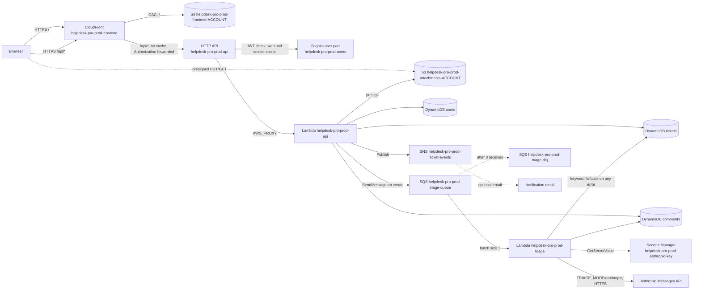

# Helpdesk Pro: architecture

Production stack for the support ticketing app. Everything is in AWS, managed by Terraform in `/infra`
(state bootstrapped by `/infra/bootstrap`). Every resource name is explicit and carries the
`helpdesk-pro-prod-` prefix. S3 bucket names also carry the AWS account ID, because S3 names are global:
`helpdesk-pro-prod-attachments-<account-id>`, `helpdesk-pro-prod-frontend-<account-id>`,
`helpdesk-pro-prod-tfstate-<account-id>`. No random suffixes are used anywhere.

## Request and data flow



The triage Lambda runs outside a VPC, so it reaches the Anthropic API over the public internet without a
NAT gateway.

Triage: a ticket creation enqueues a message. The triage Lambda asks Claude (through the Anthropic Messages
API, model `ANTHROPIC_MODEL`) for category, priority, sentiment, a one-line summary and a suggested reply.
On any failure (network, timeout, HTTP error, invalid JSON or enum, missing key, unreadable secret) it applies
the keyword rules, so ticket creation never fails. The API key is read at runtime from Secrets Manager and is
cached in the Lambda's memory. It is never in code, Terraform state, GitHub, CI logs, the frontend bundle or
any log line.

Ticket triage fields:

| Field | Visible to | Meaning |
|---|---|---|
| `triage_source` | everyone | `ai` or `rules`. Absent while triage is pending. |
| `triage_model` | everyone | The model name when `triage_source` is `ai`, otherwise null. |
| `triage_error` | agents, admins | Short fixed reason when AI failed and rules were used. |
| `suggested_reply` | agents, admins | Suggested reply text. |

## Deployment

- **Bootstrap** (`/infra/bootstrap`): run once, from a workstation with the target account, through
  `create-state.sh --yes` with `EXPECTED_ACCOUNT_ID` set. It creates the state bucket
  `helpdesk-pro-prod-tfstate-<account-id>` and lock table `helpdesk-pro-prod-tflock`. Its own state is local.
- **Main stack** (`/infra`): the `deploy` workflow (`.github/workflows/deploy.yml`, `workflow_dispatch` only) has
  two jobs:
  - `plan` (no GitHub environment): logs in through OIDC, resolves the account ID, runs `terraform init` with the
    backend settings passed explicitly, runs `terraform plan -out=tfplan`, writes the plan text into the job
    summary, and uploads `tfplan` as an artifact with one day of retention. Nothing changes in AWS in this job.
  - `apply` (`needs: plan`, `environment: production` with required reviewers): logs in through OIDC, resolves the
    account ID, runs `terraform init`, downloads `tfplan` and runs `terraform apply tfplan`. Apply uses only that
    saved plan: there is no `-auto-approve`. Then it builds the frontend in Cognito mode, syncs it to S3,
    invalidates CloudFront and runs the AI triage smoke test.
- **Sensitive artifact.** The `tfplan` artifact is sensitive. The saved plan file can hold values in clear text,
  while the job summary shows Terraform's masked text. Anyone with read access to the repository's Actions runs can
  download it until it expires, so retention is one day. Never add state, `.terraform` or provider files to that
  upload. No secret is in the artifact or the summary: the Anthropic key is not in Terraform (no version is
  created), and the smoke password is a GitHub secret that Terraform never reads. The notification email is a
  sensitive Terraform variable, so the summary masks it.
- **Approval timing.** The reviewer approves the `apply` job, which starts only after `plan` has finished. The plan
  text is in the `plan` run's job summary before anyone approves. Terraform refuses to apply the saved plan if the
  state changed after it was made. To stop a change, do not approve the `apply` job.
- **Plan job trust (decision needed).** The `plan` job has no environment, so its OIDC subject is
  `repo:<OWNER>/<REPO>:ref:refs/heads/main`, not `environment:production`. The deploy role's trust policy therefore
  accepts both subjects (see the deploy role section). That lets any workflow run on `main` assume the same deploy
  role without the production approval, and the role can do everything its policy allows. Before the first deploy,
  the person and RILEY need to accept this, or require branch protection on `main`. The better fix is a separate
  read-only plan role that only trusts `main`, with the deploy role limited to `environment:production`.
- Terraform is pinned to 1.17.0 in the workflow (`TERRAFORM_VERSION`).
- Terraform is pinned to 1.17.0 in the workflow (`TERRAFORM_VERSION`).

### Terraform init (run from `/infra`)

The backend block is empty on purpose, because backend settings cannot use variables and the state bucket
name includes the account ID. Pass every setting:

```bash
ACCOUNT_ID="$(aws sts get-caller-identity --query Account --output text)"
cd infra
terraform init -input=false \
  -backend-config="bucket=helpdesk-pro-prod-tfstate-${ACCOUNT_ID}" \
  -backend-config="key=helpdesk-pro-prod/terraform.tfstate" \
  -backend-config="region=us-east-1" \
  -backend-config="dynamodb_table=helpdesk-pro-prod-tflock" \
  -backend-config="encrypt=true"
```

### Smoke test flow

1. The workflow signs in with `aws cognito-idp initiate-auth --auth-flow USER_PASSWORD_AUTH` against the
   smoke app client (`helpdesk-pro-prod-smoke`, output `smoke_user_pool_client_id`). The email and password
   come from the `production` environment secrets `SMOKE_USER_EMAIL` and `SMOKE_USER_PASSWORD`.
2. The workflow reads `IdToken`, masks it with `::add-mask::`, and passes it to
   `backend/scripts/smoke_triage.py` as `SMOKE_ID_TOKEN`. The site root comes from `deployed_url`.
3. The script creates a ticket titled `[smoke test] AI triage check <time>` through `/api/tickets` and waits for
   triage. It passes only when `triage_source` is `ai`.

The HTTP API JWT authorizer accepts ID tokens for both app clients (`web` and `smoke`). The web client keeps
SRP only. Only the smoke client allows password sign-in.

**The first deploy is expected to fail at the smoke test** until the Anthropic key is set (triage falls back to
rules, so `triage_source` is `rules`). Set the key (step 2 below), then re-run the workflow. Terraform apply is
a no-op on the second run.

## One-time steps (done by the person)

Run these in the person's own terminal, with their own AWS and GitHub credentials. Do not paste keys or
passwords into chat or shell history.

1. **Bootstrap the state bucket and lock table.**
   `EXPECTED_ACCOUNT_ID=<account-id> AWS_REGION=us-east-1 ./infra/bootstrap/create-state.sh` (prints what it
   will create, then exits 1). Run it again with `--yes` to apply.
2. **Set the Anthropic API key** (after the first apply, before the smoke test passes). The key needs an
   Anthropic account with API billing. Create it in the Anthropic console, then:

   ```bash
   read -rs KEY && aws secretsmanager put-secret-value --secret-id helpdesk-pro-prod-anthropic-key --secret-string "$KEY" && unset KEY
   ```

   Terraform creates the secret with no value. Nothing else in the repo or the pipeline reads or prints the value.
3. **Create the smoke customer** in the user pool `helpdesk-pro-prod-users`. Choose the email, do not add it
   to any group (no group means Customer), and set a permanent password:

   ```bash
   POOL_ID="<user_pool_id output>"
   SMOKE_EMAIL="<the email you choose>"
   read -rs SMOKE_PW && echo
   aws cognito-idp admin-create-user --user-pool-id "$POOL_ID" --username "$SMOKE_EMAIL" \
     --message-action SUPPRESS \
     --user-attributes Name=email,Value="$SMOKE_EMAIL" Name=email_verified,Value=true
   aws cognito-idp admin-set-user-password --user-pool-id "$POOL_ID" --username "$SMOKE_EMAIL" \
     --password "$SMOKE_PW" --permanent
   unset SMOKE_PW
   ```

   A permanent password is required. A temporary password returns a challenge, not an ID token, and the
   workflow stops with a clear error.
4. **Store the smoke user as environment secrets.** On the `production` environment, add `SMOKE_USER_EMAIL`
   and `SMOKE_USER_PASSWORD`. Use the GitHub settings page, or `gh secret set SMOKE_USER_PASSWORD --env production`
   and type the value at the prompt. Do not pass the password as a command argument.
5. **Attach the deploy policy** (see "Deploy role policy" below) to the role whose ARN is the
   `AWS_DEPLOY_ROLE_ARN` repository variable, and create its trust policy with your repository, the `production` environment and `main`.
   Terraform does not create this role.

Smoke tickets accumulate in production, one per deploy. They are titled `[smoke test]`. Close them from the agent
workspace (search for `[smoke test]`, set status to Resolved), or leave them. Nothing else reads them.

## AWS resources

### Bootstrap (`/infra/bootstrap`)

| Resource (Terraform) | Name | Purpose |
|---|---|---|
| `aws_s3_bucket.tfstate` | `helpdesk-pro-prod-tfstate-<account-id>` | Remote state for `/infra`. Versioned, AES256, public access blocked, TLS-only policy, noncurrent versions expire after 90 days (newest 10 kept). |
| `aws_s3_bucket_versioning.tfstate` | (on the state bucket) | Keeps state history for rollback. |
| `aws_s3_bucket_server_side_encryption_configuration.tfstate` | (on the state bucket) | Encrypts state at rest. |
| `aws_s3_bucket_public_access_block.tfstate` | (on the state bucket) | Blocks all public access. |
| `aws_s3_bucket_ownership_controls.tfstate` | (on the state bucket) | BucketOwnerEnforced. |
| `aws_s3_bucket_lifecycle_configuration.tfstate` | (on the state bucket) | Expires old state versions, aborts stale multipart uploads after 7 days. |
| `aws_s3_bucket_policy.tfstate` | (on the state bucket) | Denies any request that is not over TLS. |
| `aws_dynamodb_table.tflock` | `helpdesk-pro-prod-tflock` | Terraform state lock (on-demand, hash key `LockID`, PITR, encryption). |

### Main stack (`/infra`)

#### Data

| Resource (Terraform) | Name | Purpose |
|---|---|---|
| `aws_dynamodb_table.tickets` | `helpdesk-pro-prod-tickets` | Tickets (hash key `id`). GSIs: `by_requester` (`requester_sub`, `created_at`), `by_assignee` (`assignee_id`, `updated_at`), `by_status` (`status`, `updated_at`), all projecting ALL attributes. On-demand, PITR, encryption. |
| `aws_dynamodb_table.comments` | `helpdesk-pro-prod-comments` | Public replies, internal notes, activity timeline and triage comments (hash `ticket_id`, range `sort_key`). |
| `aws_dynamodb_table.users` | `helpdesk-pro-prod-users` | User profile and role cache (hash `user_id`). GSI `by_role` (`role`, `user_id`), projecting ALL, for the user management screen. On-demand, PITR, encryption. |
| `aws_s3_bucket.attachments` | `helpdesk-pro-prod-attachments-<account-id>` | Private ticket screenshots under the `attachments/` prefix. Versioned, AES256, public access blocked, TLS-only. |
| `aws_s3_bucket_versioning.attachments` | (on attachments bucket) | Versioning. |
| `aws_s3_bucket_server_side_encryption_configuration.attachments` | (on attachments bucket) | AES256 encryption. |
| `aws_s3_bucket_public_access_block.attachments` | (on attachments bucket) | Blocks all public access. |
| `aws_s3_bucket_ownership_controls.attachments` | (on attachments bucket) | BucketOwnerEnforced. |
| `aws_s3_bucket_lifecycle_configuration.attachments` | (on attachments bucket) | Noncurrent versions expire after 30 days; stale multipart uploads aborted after 7 days. |
| `aws_s3_bucket_cors_configuration.attachments` | (on attachments bucket) | Allows GET and PUT from the CloudFront origin only (browser uploads). |
| `aws_s3_bucket_policy.attachments` | (on attachments bucket) | Denies any request that is not over TLS. |
| `aws_secretsmanager_secret.anthropic_key` | `helpdesk-pro-prod-anthropic-key` | Anthropic API key for triage. Description, 30-day recovery window, AWS-managed key, `prevent_destroy`. Terraform creates no version and holds no value. Set by the one-time step above. |

#### Auth

| Resource (Terraform) | Name | Purpose |
|---|---|---|
| `aws_cognito_user_pool.users` | `helpdesk-pro-prod-users` | User directory, email sign-in, deletion protection on. |
| `aws_cognito_user_pool_client.web` | `helpdesk-pro-prod-web` | SPA client: SRP sign-in and refresh tokens, no client secret. Users can write `email` only; `name` is admin-managed. |
| `aws_cognito_user_pool_client.smoke` | `helpdesk-pro-prod-smoke` | Deploy smoke test only: password sign-in and refresh, no client secret, 60-minute ID and access tokens, 1-day refresh. The only client that allows `USER_PASSWORD_AUTH`. Users can write `email` only. |
| `aws_cognito_user_group.customer` | `Customer` | Role: sees only own tickets. |
| `aws_cognito_user_group.agent` | `Agent` | Role: sees and works all tickets. |
| `aws_cognito_user_group.admin` | `Admin` | Role: agent rights plus dashboard and user management. |

#### Messaging

| Resource (Terraform) | Name | Purpose |
|---|---|---|
| `aws_sqs_queue.triage` | `helpdesk-pro-prod-triage-queue` | Triage work queue. Visibility timeout 360s (6 x the 60s triage timeout). |
| `aws_sqs_queue.triage_dlq` | `helpdesk-pro-prod-triage-dlq` | Dead-letter queue after 3 failed receives. Retains 14 days. |
| `aws_sqs_queue_redrive_allow_policy.triage_dlq` | (on the DLQ) | Lets only the triage queue redrive into the DLQ. |
| `aws_sns_topic.ticket_events` | `helpdesk-pro-prod-ticket-events` | Assignment and reply notifications. |
| `aws_sns_topic_subscription.ticket_events_email` | (no name; created only if `notification_email` is set) | Email subscription to the topic. |

#### Compute and access

| Resource (Terraform) | Name | Purpose |
|---|---|---|
| `aws_lambda_function.api` | `helpdesk-pro-prod-api` | REST API handler (`helpdesk.api_handler.handler`), Python 3.12, 30s. No secret access. |
| `aws_lambda_function.triage` | `helpdesk-pro-prod-triage` | Ticket triage (`helpdesk.triage_handler.handler`), Python 3.12, 60s, outside a VPC. |
| `aws_lambda_event_source_mapping.triage` | (no name) | Triage queue to triage Lambda. Batch size 1, partial batch responses. |
| `aws_lambda_permission.api_gateway` | `AllowHttpApiInvoke` | Lets the HTTP API invoke the API Lambda. |
| `aws_iam_role.api` | `helpdesk-pro-prod-api-role` | Execution role for the API Lambda. |
| `aws_iam_role_policy.api` | `helpdesk-pro-prod-api-policy` | Scoped to the three tables and their indexes (`/index/*`), the attachments prefix, the triage queue, the ticket events topic, and the user pool. The user pool statement allows `cognito-idp:ListUsers`, `AdminListGroupsForUser`, `AdminAddUserToGroup`, `AdminRemoveUserFromGroup` and `AdminUserGlobalSignOut` (role changes; demotion signs the user out at once). |
| `aws_iam_role.triage` | `helpdesk-pro-prod-triage-role` | Execution role for the triage Lambda. |
| `aws_iam_role_policy.triage` | `helpdesk-pro-prod-triage-policy` | Queue consume, ticket and comment access, `secretsmanager:GetSecretValue` on the Anthropic key secret only. |
| `aws_cloudwatch_log_group.api` | `/aws/lambda/helpdesk-pro-prod-api` | API Lambda logs, 30-day retention. |
| `aws_cloudwatch_log_group.triage` | `/aws/lambda/helpdesk-pro-prod-triage` | Triage Lambda logs, 30-day retention. |
| `aws_cloudwatch_log_group.api_access` | `/aws/apigateway/helpdesk-pro-prod-api` | HTTP API access logs, 30-day retention. |

#### API

| Resource (Terraform) | Name | Purpose |
|---|---|---|
| `aws_apigatewayv2_api.api` | `helpdesk-pro-prod-api` | HTTP API. |
| `aws_apigatewayv2_authorizer.cognito` | `helpdesk-pro-prod-cognito` | JWT authorizer. Audience: the `web` and `smoke` app clients. |
| `aws_apigatewayv2_integration.api` | (no name) | AWS_PROXY integration to the API Lambda (payload format 2.0). |
| `aws_apigatewayv2_route.default` | `$default` | Sends every request through the JWT authorizer to the API Lambda. |
| `aws_apigatewayv2_stage.default` | `$default` | Auto-deployed stage with throttling and access logs. |

#### Frontend and CDN

| Resource (Terraform) | Name | Purpose |
|---|---|---|
| `aws_s3_bucket.frontend` | `helpdesk-pro-prod-frontend-<account-id>` | Built SPA. Private, AES256, public access blocked. |
| `aws_s3_bucket_server_side_encryption_configuration.frontend` | (on frontend bucket) | AES256 encryption. |
| `aws_s3_bucket_public_access_block.frontend` | (on frontend bucket) | Blocks all public access. |
| `aws_s3_bucket_ownership_controls.frontend` | (on frontend bucket) | BucketOwnerEnforced. |
| `aws_s3_bucket_policy.frontend` | (on frontend bucket) | Allows read and list only for this CloudFront distribution (`AWS:SourceArn`), and denies non-TLS. |
| `aws_cloudfront_origin_access_control.frontend` | `helpdesk-pro-prod-frontend-oac` | Signs CloudFront requests to the frontend bucket (SigV4). |
| `aws_cloudfront_function.spa_rewrite` | `helpdesk-pro-prod-spa-rewrite` | Rewrites extensionless paths to `/index.html`. |
| `aws_cloudfront_response_headers_policy.frontend` | `helpdesk-pro-prod-frontend-headers` | Response headers for `/` (the SPA). The managed security headers (HSTS, nosniff, `X-Frame-Options: SAMEORIGIN`, referrer policy, XSS filter) plus a Content-Security-Policy: `default-src 'self'`; `script-src 'self'` plus the hash of the one inline theme script in `frontend/index.html`; `style-src 'self' 'unsafe-inline'`; `img-src 'self' data:`; `connect-src` to `'self'`, the Cognito IDP endpoint of the region, and the attachments bucket (presigned uploads); `frame-ancestors 'none'`; `base-uri 'self'`; `form-action 'self'`. **If the inline script in `frontend/index.html` changes, update the hash in `infra/frontend.tf`.** Compute it from the script text as Vite emits it in `frontend/dist/index.html`. A stale hash does not break the page, but the theme is not applied before first paint. Keeping `unsafe-inline` out of `script-src` is what gives the protection. |
| `aws_cloudfront_distribution.frontend` | comment `helpdesk-pro-prod-frontend` | Serves `/` from S3 with the response headers policy above, and `/api/*` from the HTTP API with the managed security headers. HTTPS only, compression. |

Outputs (`/infra/outputs.tf`): `deployed_url`, `api_endpoint`, `user_pool_id`, `user_pool_client_id`,
`smoke_user_pool_client_id`, `attachments_bucket`, `frontend_bucket`, `cloudfront_distribution_id`,
`triage_queue_url`, `ticket_events_topic_arn`.

## Deploy role policy

Policy name: `helpdesk-pro-prod-deploy-policy`. Attach it to the role named by the `AWS_DEPLOY_ROLE_ARN`
repository variable. Replace `<ACCOUNT_ID>` with the account ID. The role's trust policy must allow only this
repository's `production` environment (the `apply` job) and its `main` branch (the `plan` job, which has no
environment; see the plan job trust note above):

```json
{
  "Version": "2012-10-17",
  "Statement": [
    {
      "Effect": "Allow",
      "Principal": { "Federated": "arn:aws:iam::<ACCOUNT_ID>:oidc-provider/token.actions.githubusercontent.com" },
      "Action": "sts:AssumeRoleWithWebIdentity",
      "Condition": {
        "StringEquals": {
          "token.actions.githubusercontent.com:aud": "sts.amazonaws.com",
          "token.actions.githubusercontent.com:sub": [
            "repo:<OWNER>/<REPO>:environment:production",
            "repo:<OWNER>/<REPO>:ref:refs/heads/main"
          ]
        }
      }
    }
  ]
}
```

```json
{
  "Version": "2012-10-17",
  "Statement": [
    {
      "Sid": "TerraformStateLock",
      "Effect": "Allow",
      "Action": ["dynamodb:GetItem", "dynamodb:PutItem", "dynamodb:DeleteItem", "dynamodb:DescribeTable"],
      "Resource": "arn:aws:dynamodb:us-east-1:<ACCOUNT_ID>:table/helpdesk-pro-prod-tflock"
    },
    {
      "Sid": "TerraformStateObjects",
      "Effect": "Allow",
      "Action": ["s3:ListBucket", "s3:GetBucketVersioning"],
      "Resource": "arn:aws:s3:::helpdesk-pro-prod-tfstate-<ACCOUNT_ID>"
    },
    {
      "Sid": "TerraformStateKey",
      "Effect": "Allow",
      "Action": ["s3:GetObject", "s3:PutObject", "s3:DeleteObject"],
      "Resource": "arn:aws:s3:::helpdesk-pro-prod-tfstate-<ACCOUNT_ID>/helpdesk-pro-prod/*"
    },
    {
      "Sid": "AppBuckets",
      "Effect": "Allow",
      "Action": [
        "s3:ListBucket",
        "s3:GetObject",
        "s3:PutObject",
        "s3:DeleteObject",
        "s3:CreateBucket",
        "s3:DeleteBucket",
        "s3:GetBucketLocation",
        "s3:GetBucketVersioning",
        "s3:PutBucketVersioning",
        "s3:GetEncryptionConfiguration",
        "s3:PutEncryptionConfiguration",
        "s3:GetBucketPublicAccessBlock",
        "s3:PutBucketPublicAccessBlock",
        "s3:GetBucketOwnershipControls",
        "s3:PutBucketOwnershipControls",
        "s3:GetLifecycleConfiguration",
        "s3:PutLifecycleConfiguration",
        "s3:GetBucketCORS",
        "s3:PutBucketCORS",
        "s3:GetBucketPolicy",
        "s3:PutBucketPolicy",
        "s3:GetBucketAcl",
        "s3:GetBucketTagging",
        "s3:PutBucketTagging",
        "s3:GetBucketLogging",
        "s3:GetAccelerateConfiguration",
        "s3:GetBucketRequestPayment",
        "s3:GetBucketObjectLockConfiguration",
        "s3:GetReplicationConfiguration",
        "s3:GetBucketWebsite"
      ],
      "Resource": [
        "arn:aws:s3:::helpdesk-pro-prod-attachments-<ACCOUNT_ID>",
        "arn:aws:s3:::helpdesk-pro-prod-attachments-<ACCOUNT_ID>/*",
        "arn:aws:s3:::helpdesk-pro-prod-frontend-<ACCOUNT_ID>",
        "arn:aws:s3:::helpdesk-pro-prod-frontend-<ACCOUNT_ID>/*"
      ]
    },
    {
      "Sid": "DenyAppBucketAclWrites",
      "Effect": "Deny",
      "Action": ["s3:PutBucketAcl", "s3:PutObjectAcl"],
      "Resource": [
        "arn:aws:s3:::helpdesk-pro-prod-attachments-<ACCOUNT_ID>",
        "arn:aws:s3:::helpdesk-pro-prod-attachments-<ACCOUNT_ID>/*",
        "arn:aws:s3:::helpdesk-pro-prod-frontend-<ACCOUNT_ID>",
        "arn:aws:s3:::helpdesk-pro-prod-frontend-<ACCOUNT_ID>/*"
      ]
    },
    {
      "Sid": "AppTables",
      "Effect": "Allow",
      "Action": [
        "dynamodb:CreateTable",
        "dynamodb:DeleteTable",
        "dynamodb:DescribeTable",
        "dynamodb:UpdateTable",
        "dynamodb:DescribeContinuousBackups",
        "dynamodb:UpdateContinuousBackups",
        "dynamodb:DescribeTimeToLive",
        "dynamodb:UpdateTimeToLive",
        "dynamodb:ListTagsOfResource",
        "dynamodb:TagResource",
        "dynamodb:UntagResource"
      ],
      "Resource": [
        "arn:aws:dynamodb:us-east-1:<ACCOUNT_ID>:table/helpdesk-pro-prod-tickets",
        "arn:aws:dynamodb:us-east-1:<ACCOUNT_ID>:table/helpdesk-pro-prod-tickets/*",
        "arn:aws:dynamodb:us-east-1:<ACCOUNT_ID>:table/helpdesk-pro-prod-comments",
        "arn:aws:dynamodb:us-east-1:<ACCOUNT_ID>:table/helpdesk-pro-prod-comments/*",
        "arn:aws:dynamodb:us-east-1:<ACCOUNT_ID>:table/helpdesk-pro-prod-users",
        "arn:aws:dynamodb:us-east-1:<ACCOUNT_ID>:table/helpdesk-pro-prod-users/*"
      ]
    },
    {
      "Sid": "Lambda",
      "Effect": "Allow",
      "Action": [
        "lambda:CreateFunction",
        "lambda:DeleteFunction",
        "lambda:GetFunction",
        "lambda:GetFunctionConfiguration",
        "lambda:UpdateFunctionCode",
        "lambda:UpdateFunctionConfiguration",
        "lambda:GetFunctionCodeSigningConfig",
        "lambda:GetFunctionConcurrency",
        "lambda:ListTags",
        "lambda:TagResource",
        "lambda:UntagResource",
        "lambda:RemovePermission",
        "lambda:GetPolicy",
        "lambda:CreateEventSourceMapping",
        "lambda:GetEventSourceMapping",
        "lambda:UpdateEventSourceMapping",
        "lambda:DeleteEventSourceMapping",
        "lambda:ListEventSourceMappings"
      ],
      "Resource": [
        "arn:aws:lambda:us-east-1:<ACCOUNT_ID>:function:helpdesk-pro-prod-api",
        "arn:aws:lambda:us-east-1:<ACCOUNT_ID>:function:helpdesk-pro-prod-api:*",
        "arn:aws:lambda:us-east-1:<ACCOUNT_ID>:function:helpdesk-pro-prod-triage",
        "arn:aws:lambda:us-east-1:<ACCOUNT_ID>:function:helpdesk-pro-prod-triage:*",
        "arn:aws:lambda:us-east-1:<ACCOUNT_ID>:event-source-mapping:*"
      ]
    },
    {
      "Sid": "LambdaApiGatewayInvokePermission",
      "Effect": "Allow",
      "Action": "lambda:AddPermission",
      "Resource": [
        "arn:aws:lambda:us-east-1:<ACCOUNT_ID>:function:helpdesk-pro-prod-api",
        "arn:aws:lambda:us-east-1:<ACCOUNT_ID>:function:helpdesk-pro-prod-api:*"
      ],
      "Condition": { "StringEquals": { "lambda:Principal": "apigateway.amazonaws.com" } }
    },
    {
      "Sid": "AppRoles",
      "Effect": "Allow",
      "Action": [
        "iam:GetRole",
        "iam:CreateRole",
        "iam:DeleteRole",
        "iam:UpdateRole",
        "iam:UpdateAssumeRolePolicy",
        "iam:PutRolePolicy",
        "iam:GetRolePolicy",
        "iam:DeleteRolePolicy",
        "iam:ListRolePolicies",
        "iam:ListAttachedRolePolicies",
        "iam:TagRole",
        "iam:UntagRole",
        "iam:ListRoleTags"
      ],
      "Resource": [
        "arn:aws:iam::<ACCOUNT_ID>:role/helpdesk-pro-prod-api-role",
        "arn:aws:iam::<ACCOUNT_ID>:role/helpdesk-pro-prod-triage-role"
      ]
    },
    {
      "Sid": "PassAppRoles",
      "Effect": "Allow",
      "Action": "iam:PassRole",
      "Resource": [
        "arn:aws:iam::<ACCOUNT_ID>:role/helpdesk-pro-prod-api-role",
        "arn:aws:iam::<ACCOUNT_ID>:role/helpdesk-pro-prod-triage-role"
      ],
      "Condition": { "StringEquals": { "iam:PassedToService": "lambda.amazonaws.com" } }
    },
    {
      "Sid": "Logs",
      "Effect": "Allow",
      "Action": [
        "logs:CreateLogGroup",
        "logs:DeleteLogGroup",
        "logs:PutRetentionPolicy",
        "logs:DeleteRetentionPolicy",
        "logs:TagResource",
        "logs:UntagResource",
        "logs:ListTagsForResource",
        "logs:ListTagsLogGroup",
        "logs:TagLogGroup",
        "logs:UntagLogGroup"
      ],
      "Resource": [
        "arn:aws:logs:us-east-1:<ACCOUNT_ID>:log-group:/aws/lambda/helpdesk-pro-prod-api",
        "arn:aws:logs:us-east-1:<ACCOUNT_ID>:log-group:/aws/lambda/helpdesk-pro-prod-api:*",
        "arn:aws:logs:us-east-1:<ACCOUNT_ID>:log-group:/aws/lambda/helpdesk-pro-prod-triage",
        "arn:aws:logs:us-east-1:<ACCOUNT_ID>:log-group:/aws/lambda/helpdesk-pro-prod-triage:*",
        "arn:aws:logs:us-east-1:<ACCOUNT_ID>:log-group:/aws/apigateway/helpdesk-pro-prod-api",
        "arn:aws:logs:us-east-1:<ACCOUNT_ID>:log-group:/aws/apigateway/helpdesk-pro-prod-api:*"
      ]
    },
    {
      "Sid": "LogsDescribe",
      "Effect": "Allow",
      "Action": "logs:DescribeLogGroups",
      "Resource": "*"
    },
    {
      "Sid": "Queues",
      "Effect": "Allow",
      "Action": [
        "sqs:CreateQueue",
        "sqs:DeleteQueue",
        "sqs:GetQueueAttributes",
        "sqs:SetQueueAttributes",
        "sqs:GetQueueUrl",
        "sqs:ListQueueTags",
        "sqs:TagQueue",
        "sqs:UntagQueue"
      ],
      "Resource": [
        "arn:aws:sqs:us-east-1:<ACCOUNT_ID>:helpdesk-pro-prod-triage-queue",
        "arn:aws:sqs:us-east-1:<ACCOUNT_ID>:helpdesk-pro-prod-triage-dlq"
      ]
    },
    {
      "Sid": "TicketEventsTopic",
      "Effect": "Allow",
      "Action": [
        "sns:CreateTopic",
        "sns:DeleteTopic",
        "sns:GetTopicAttributes",
        "sns:SetTopicAttributes",
        "sns:ListTagsForResource",
        "sns:TagResource",
        "sns:UntagResource",
        "sns:Unsubscribe",
        "sns:GetSubscriptionAttributes",
        "sns:SetSubscriptionAttributes",
        "sns:ListSubscriptionsByTopic"
      ],
      "Resource": "arn:aws:sns:us-east-1:<ACCOUNT_ID>:helpdesk-pro-prod-ticket-events"
    },
    {
      "Sid": "TicketEventsEmailSubscribe",
      "Effect": "Allow",
      "Action": "sns:Subscribe",
      "Resource": "arn:aws:sns:us-east-1:<ACCOUNT_ID>:helpdesk-pro-prod-ticket-events",
      "Condition": { "StringEquals": { "sns:Protocol": "email" } }
    },
    {
      "Sid": "UserPoolCreate",
      "Effect": "Allow",
      "Action": "cognito-idp:CreateUserPool",
      "Resource": "*"
    },
    {
      "Sid": "UserPoolManage",
      "Effect": "Allow",
      "Action": [
        "cognito-idp:DescribeUserPool",
        "cognito-idp:UpdateUserPool",
        "cognito-idp:DeleteUserPool",
        "cognito-idp:GetUserPoolMfaConfig",
        "cognito-idp:SetUserPoolMfaConfig",
        "cognito-idp:CreateUserPoolClient",
        "cognito-idp:DescribeUserPoolClient",
        "cognito-idp:UpdateUserPoolClient",
        "cognito-idp:DeleteUserPoolClient",
        "cognito-idp:CreateGroup",
        "cognito-idp:GetGroup",
        "cognito-idp:UpdateGroup",
        "cognito-idp:DeleteGroup",
        "cognito-idp:ListGroups",
        "cognito-idp:TagResource",
        "cognito-idp:UntagResource",
        "cognito-idp:ListTagsForResource"
      ],
      "Resource": "arn:aws:cognito-idp:us-east-1:<ACCOUNT_ID>:userpool/*"
    },
    {
      "Sid": "SmokeSignIn",
      "Effect": "Allow",
      "Action": "cognito-idp:InitiateAuth",
      "Resource": "arn:aws:cognito-idp:us-east-1:<ACCOUNT_ID>:userpool/*"
    },
    {
      "Sid": "AnthropicKeySecret",
      "Effect": "Allow",
      "Action": [
        "secretsmanager:CreateSecret",
        "secretsmanager:DescribeSecret",
        "secretsmanager:UpdateSecret",
        "secretsmanager:DeleteSecret",
        "secretsmanager:GetResourcePolicy",
        "secretsmanager:TagResource",
        "secretsmanager:UntagResource"
      ],
      "Resource": "arn:aws:secretsmanager:us-east-1:<ACCOUNT_ID>:secret:helpdesk-pro-prod-anthropic-key-*"
    },
    {
      "Sid": "HttpApi",
      "Effect": "Allow",
      "Action": [
        "apigateway:GET",
        "apigateway:POST",
        "apigateway:PATCH",
        "apigateway:PUT",
        "apigateway:DELETE"
      ],
      "Resource": [
        "arn:aws:apigateway:us-east-1::/apis",
        "arn:aws:apigateway:us-east-1::/apis/*",
        "arn:aws:apigateway:us-east-1::/tags/*"
      ]
    },
    {
      "Sid": "CloudFrontFunction",
      "Effect": "Allow",
      "Action": [
        "cloudfront:CreateFunction",
        "cloudfront:DescribeFunction",
        "cloudfront:GetFunction",
        "cloudfront:UpdateFunction",
        "cloudfront:PublishFunction",
        "cloudfront:DeleteFunction"
      ],
      "Resource": "arn:aws:cloudfront::<ACCOUNT_ID>:function/helpdesk-pro-prod-spa-rewrite"
    },
    {
      "Sid": "CloudFront",
      "Effect": "Allow",
      "Action": [
        "cloudfront:CreateDistribution",
        "cloudfront:CreateInvalidation",
        "cloudfront:GetDistribution",
        "cloudfront:GetDistributionConfig",
        "cloudfront:UpdateDistribution",
        "cloudfront:DeleteDistribution",
        "cloudfront:ListDistributions",
        "cloudfront:CreateOriginAccessControl",
        "cloudfront:GetOriginAccessControl",
        "cloudfront:UpdateOriginAccessControl",
        "cloudfront:DeleteOriginAccessControl",
        "cloudfront:ListOriginAccessControls",
        "cloudfront:ListFunctions",
        "cloudfront:TagResource",
        "cloudfront:UntagResource",
        "cloudfront:ListTagsForResource"
      ],
      "Resource": "*"
    }
  ]
}
```

Every resource ARN in this policy is named (account, region and resource name) except where AWS does not allow
it. The wildcards that remain are listed here with the reason each one stays:

| Statement | Wildcard | Why it cannot be narrowed |
|---|---|---|
| `AnthropicKeySecret` | `secret:helpdesk-pro-prod-anthropic-key-*` | Secrets Manager appends a random six-character suffix to every secret ARN. `-*` matches only that suffix. |
| `UserPoolCreate` | `Resource: "*"` | `cognito-idp:CreateUserPool` is authorised before the pool exists, so there is no ARN to name. |
| `UserPoolManage`, `SmokeSignIn` | `userpool/*` | AWS generates the pool ID (`us-east-1_...`) on creation. Once the pool exists, its ID can replace the wildcard. |
| `SmokeSignIn` | `InitiateAuth` on the pool | IAM cannot limit `InitiateAuth` to one app client. Cognito enforces it: only the `smoke` client allows `USER_PASSWORD_AUTH`. |
| `LogsDescribe` | `Resource: "*"` | `logs:DescribeLogGroups` does not support resource-level permissions. Terraform uses it to read the log groups it manages. |
| `Lambda` | `event-source-mapping:*` | The mapping ARN ends in a UUID that AWS assigns on creation. |
| `HttpApi` | `/apis`, `/apis/*`, `/tags/*` | The HTTP API ID is assigned by AWS on creation, so `/apis` (create) cannot be named. |
| `CloudFront` | `Resource: "*"` (distribution, invalidation and OAC actions) | Distribution and OAC IDs are assigned on creation. The distribution actions are the broadest remaining statement. Narrow them with a tag condition once the distribution's tags are fixed. |

No action-level wildcards remain. Every statement lists its actions by name. The explicit lists were derived from the
resource types in `/infra`. The first `terraform plan` may still show an action the lists do not cover (the provider
can read more than the resource block suggests). Add each such action by name, not as a wildcard.

Other statements added in this revision:

- `AppBuckets` grants no ACL writes. `DenyAppBucketAclWrites` explicitly denies `s3:PutBucketAcl` and
  `s3:PutObjectAcl` on both buckets. The buckets use `BucketOwnerEnforced`, so ACLs are never needed.
- `LambdaApiGatewayInvokePermission` allows `lambda:AddPermission` only when the principal is
  `apigateway.amazonaws.com` (`infra/api.tf:74-79`).
- `TicketEventsEmailSubscribe` allows `sns:Subscribe` only for the `email` protocol (`infra/messaging.tf:37-41`).
- `CloudFrontFunction` is scoped to the function name `helpdesk-pro-prod-spa-rewrite` (`infra/frontend.tf:45-46`),
  which is fixed in code, so it is known before creation.

Other limits, stated plainly:

- This policy was written from the resources in `/infra` and has **not been tested against a real plan or
  apply**.
- The deploy role **can** read the Anthropic key value, indirectly. It can rewrite the triage role's trust policy
  and inline policies (`iam:UpdateAssumeRolePolicy`, `iam:PutRolePolicy` on `helpdesk-pro-prod-triage-role`), add
  itself as a principal, and then call `secretsmanager:GetSecretValue`, which the triage role holds
  (`infra/lambda.tf:180-183`). It can also update the triage function code (`lambda:UpdateFunctionCode`) and run
  code as that role. Terraform needs both actions to manage the app roles and functions, so they cannot be removed
  here. The controls that remain are the `production` environment with required reviewers for the apply, and the
  OIDC trust condition on `sub`. The `plan` job's `main` subject adds a route to the same role with no reviewer
  (see Main stack). **The person has to accept this risk.** Options: accept it (the current choice,
  recommended for the first deploy and to be revisited if the deploy role gets a second user), or add a permissions
  boundary and a condition on the IAM actions (this does not stop the Lambda code path).
- The deploy role has no permission to write the Anthropic key value, to read the smoke password, or to manage IAM
  users, Admin group membership or Cognito user passwords.

## External services used (not created here)

- **Anthropic API**: the triage Lambda calls `https://api.anthropic.com/v1/messages` with the model in
  `anthropic_model` (default `claude-haiku-5-5`). The account needs API billing and the model must be available
  to it. Nothing here calls the API until the key is set.
- **GitHub**: the `production` environment (required reviewers), repository variables `AWS_DEPLOY_ROLE_ARN` and
  `NOTIFICATION_EMAIL`, environment secrets `SMOKE_USER_EMAIL` and `SMOKE_USER_PASSWORD`, and the GitHub OIDC
  identity provider in the AWS account.

## Cost estimate

Assumes 1,000 tickets a month. Check prices against current Anthropic and AWS pricing before the first deploy.

| Item | Estimate | Notes |
|---|---|---|
| AWS Secrets Manager, one secret | about $0.40 per month | Per secret per month. The Lambda caches the key, so API call charges are negligible. |
| Anthropic API (triage) | about $1 to $5 per month | Haiku-class list prices, roughly a few thousand tokens per ticket (prompt with the ticket plus the reply). |

The other services are usage-priced: Lambda, API Gateway (HTTP API), DynamoDB on-demand, SQS, SNS, S3,
CloudFront, Cognito and CloudWatch Logs. The full monthly estimate, with its assumptions, is in `README.md`
(Cost estimate).

## Open decisions

Nothing below is built or decided for the person.

1. **Anthropic key.** Confirm the account has API billing, create the key, and run the one-time command. Until
   then triage is rules-only and the first deploy's smoke test fails by design.
2. **Model name.** `claude-haiku-5-5` is the default. It has not been checked against the Anthropic account. Confirm
   it, or set `anthropic_model` (the workflow passes no override, so change the default in `variables.tf`).
3. **Smoke customer.** Choose the email, create the user, set its permanent password and the two GitHub secrets.
4. **Deploy role.** Create the OIDC role, replace `<OWNER>/<REPO>` in the trust policy, and attach the deploy policy.
   Terraform does not create this role.
5. **Notifications.** Set `NOTIFICATION_EMAIL` to subscribe an address to ticket events, or leave it empty.
6. **Deploy role and the Anthropic key.** Accept, in writing, that the deploy role can reach the key through the
   triage role or the triage function code (see the deploy role section), or ask for a permissions boundary and a
   separate triage deploy path before the first deploy.
